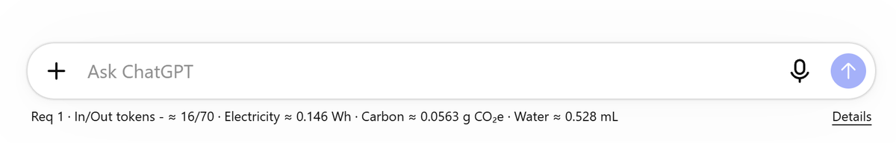
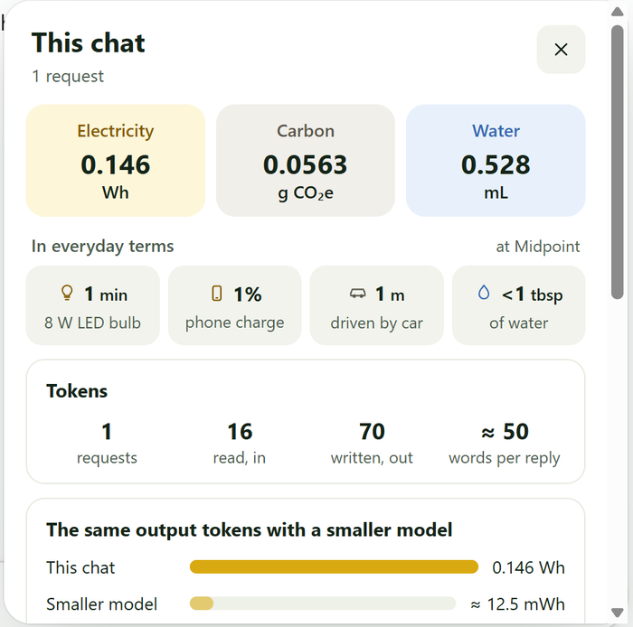
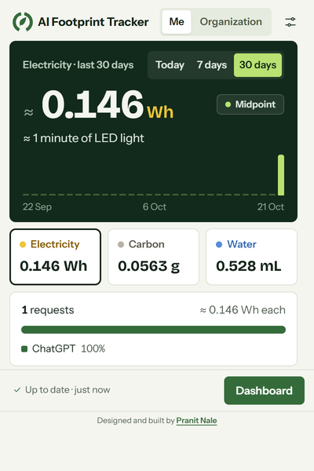
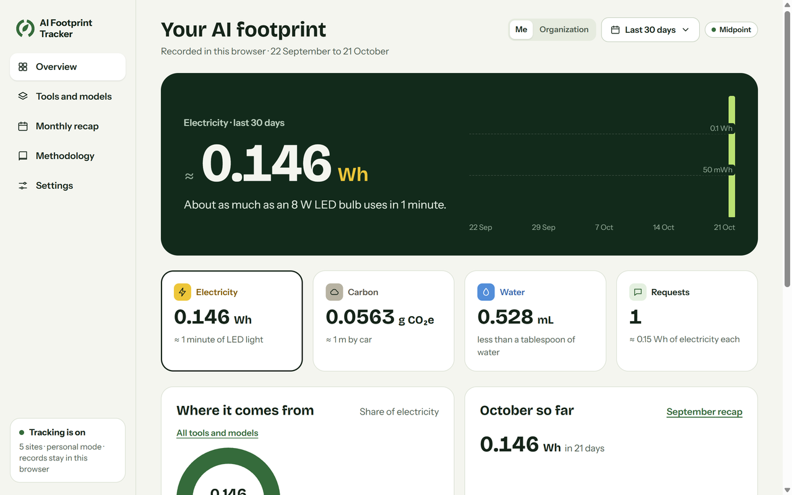
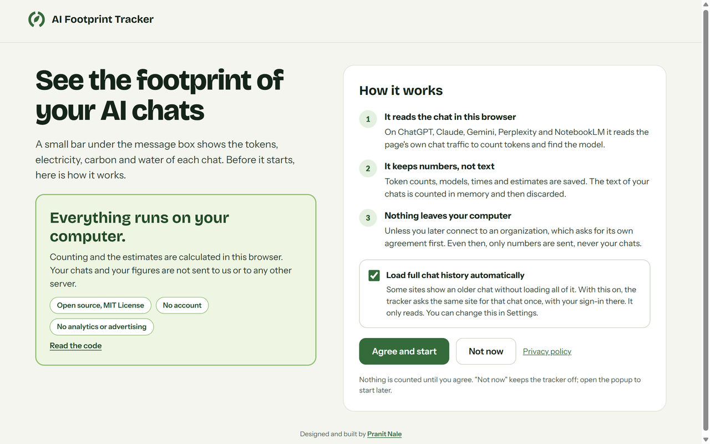
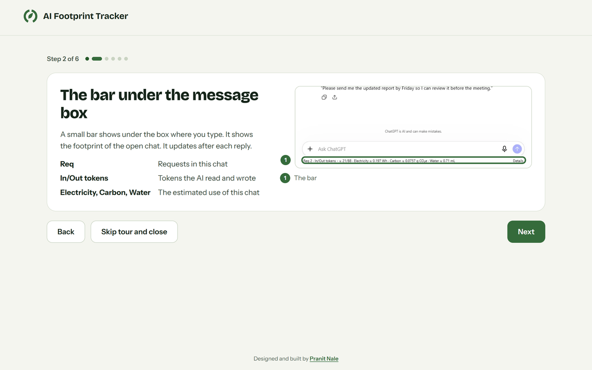
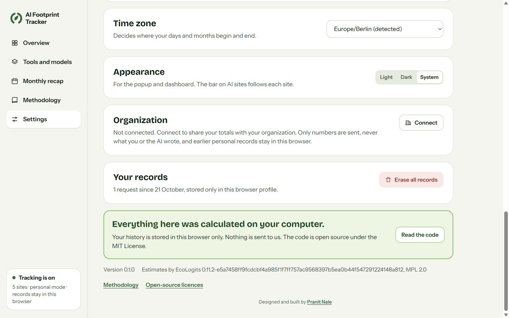
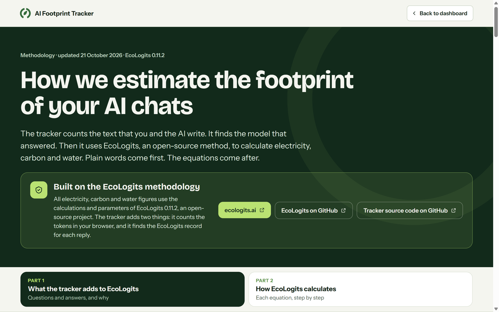

# AI Footprint Tracker

**See the electricity, carbon and water behind your AI chats.**

AI Footprint Tracker is a browser extension for Chrome, Edge and Firefox. It works on ChatGPT, Claude, Gemini, Perplexity and NotebookLM. It counts the tokens of each chat in your browser. Then it estimates the electricity, carbon and water that the AI used. Everything is calculated on your computer, and your chats stay in your browser.

[Website](https://aifootprinttracker.com) · [Download](https://aifootprinttracker.com/download) · [Methodology](https://aifootprinttracker.com/methodology) · [Privacy](https://aifootprinttracker.com/privacy) · [MIT License](LICENSE)


A longer version of this demo is in [`docs/media/demo.mp4`](docs/media/demo.mp4).

> [!NOTE]
> The figures are estimates, not meter readings. AI providers do not publish the energy use of each request. The tracker uses the open [EcoLogits](https://ecologits.ai) method and shows every figure as a range. This project is independent. It is not affiliated with or endorsed by OpenAI, Anthropic, Google, Perplexity or EcoLogits.

## What you see

| The bar under the message box | Details |
|---|---|
|  |  |
| A small bar shows the footprint of the open chat. It updates after each reply. | Details shows the full figures, everyday comparisons, the tokens and how each figure is estimated. |

| The popup | The dashboard |
|---|---|
|  |  |
| Click the tracker's logo in the toolbar. See today, 7 days or 30 days, split by AI tool. | See your totals over time, each AI tool and model, a monthly recap and the methodology. |

| The welcome page | The short tour |
|---|---|
|  |  |
| Nothing is counted before you agree. The page says what the tracker reads and keeps. | After you agree, six short steps show the bar, Details, the popup, the dashboard and privacy. |

| Settings | The methodology |
|---|---|
|  |  |
| Choose the low, midpoint or high end of each estimate. Pause, erase or withdraw your agreement. | Each step of the estimate in plain words, with sources. |

## How it works

1. **Install the extension.** See [Install](#install) below.
2. **Agree to tracking.** A welcome page opens. It explains what the tracker reads and keeps. Nothing is counted before you agree. After you agree, a short tour shows where to find everything.
3. **Chat as usual.** Use your AI tool as you always do. The bar under the message box shows the footprint of the chat.
4. **Look at the details.** Select Details on the bar. Click the tracker's logo for the popup. Open the dashboard for your totals.

Behind the bar, the tracker does these steps for each reply:

1. It reads the chat traffic of the page in your browser.
2. It counts the tokens of your message, your files and the reply. It uses the o200k_base tokenizer in a background process.
3. It finds the model that wrote the reply.
4. It gives the output tokens, the model and the reply time to EcoLogits. EcoLogits calculates the electricity.
5. It converts the electricity into carbon and water for the provider's data centres.

The [methodology](https://aifootprinttracker.com/methodology) explains each step in plain words, with sources. The [technical reference](docs/methodology/content.html) has every rule in full.

## Privacy

- The tracker counts the text of your chats in memory. It keeps only numbers, such as token counts, model names and times. It never stores or sends the text.
- For personal use, nothing is sent to us. You do not need an account. There is no analytics and no advertising.
- If you connect to an organization, only numbers are shared with it. Your messages, the AI's replies, files and chat titles are never shared.
- You can pause tracking, erase all records or withdraw your agreement in Settings at any time.

## Install

The extension is not in a browser store yet. The packages on the website are unsigned test packages, version 0.1.0. Review the source before you roll them out.

**Chrome and Edge**

1. Download the package from [aifootprinttracker.com/download](https://aifootprinttracker.com/download) and unzip it. Keep the unzipped folder somewhere it will stay.
2. Go to `chrome://extensions` or `edge://extensions` and turn on Developer mode.
3. Choose Load unpacked and select the unzipped folder.
4. Pin AI Footprint Tracker to the toolbar. Then open any supported AI chat.

**Firefox**

1. Download the Firefox package and keep the file somewhere it will stay.
2. Go to `about:debugging` and choose This Firefox.
3. Choose Load Temporary Add-on and select the package file.
4. Open any supported AI chat. The bar shows below the message box.

To build the packages yourself, see [Build from source](#build-from-source).

## For organizations

An organization can see the total footprint of its members. A member connects the extension with a work email and a code that is sent to that email. The server assigns the organization that is registered for the email's domain. Only administrators sign in on the website. Only numbers that are recorded after the connection are shared. Personal history is not uploaded.

You can use the hosted service at [aifootprinttracker.com](https://aifootprinttracker.com) or host the server yourself. See [Self-hosting](#self-hosting).

## Build from source

Use Node 22.23.2, pnpm 11.19.0, uv 0.11.28 and Python 3.13.15. From a clean checkout:

```sh
corepack enable
corepack prepare pnpm@11.19.0 --activate
pnpm install --frozen-lockfile
uv sync --project apps/server --frozen --group dev --python 3.13.15
pnpm typecheck
pnpm test
```

The TypeScript parity tests run `apps/server/.venv` directly. You do not need to activate a shell or install other calibration tools. Run the `uv sync` command again after a Python dependency changes.

`pnpm check` runs the full release gate: documentation checks, Python lint and tests, dependency audits, all browser packages, the source-archive check and the website build. Some audit and deployment checks need network access, Docker or an approved PostgreSQL target. See [`docs/operations/RELEASE.md`](docs/operations/RELEASE.md).

**Browser packages.** Build the unpacked extensions with:

```sh
pnpm build:browsers
```

The output folders are `apps/extension/.output/chrome-mv3`, `apps/extension/.output/edge-mv3` and `apps/extension/.output/firefox-mv2`. Load the matching folder in your browser's extension page with Developer mode on. In Firefox, select the folder's `manifest.json` on the debugging page. These steps do not bypass browser signing and do not prove store compatibility.

Make the reviewed, reproducible unsigned packages and copy them into the website with:

```sh
pnpm package:browsers
pnpm verify:source-archive
```

The source ZIP holds only what a rebuild needs. Its [`BROWSER-SOURCE-README.md`](BROWSER-SOURCE-README.md) lists the supported commands. The release manifest and hashes go to `artifacts/browser`. Known limits of manual installation are in [`apps/extension/RELEASE-EVIDENCE.md`](apps/extension/RELEASE-EVIDENCE.md#native-installation-handoff).

**Website.** Build it with:

```sh
pnpm --filter @footprint/web build
```

The result goes to `apps/web/dist`. A production build offers the browser downloads only after the packaging and source checks above. The web container serves this folder behind the deployment proxy.

## Self-hosting

Start with the [self-hosted operations guide](docs/operations/SELF-HOSTING.md) and the [deployment file reference](deploy/README.md). [`compose.yaml`](compose.yaml) defines PostgreSQL, a one-time migration, the API, the maintenance worker and an HTTPS reverse proxy with a separate operator origin.

Copy the files in [`deploy/examples`](deploy/examples) to protected paths outside the checkout. Replace every placeholder. Keep settings, database passwords, TLS keys and the deletion journal out of the checkout and the Docker build context. Set a verification flag only after its DNS, TLS, mail, policy or restore check passed.

The repository does not supply DNS, certificates, a Brevo account, backup storage or operator identities. These commands do not deploy or publish anything. The operations guide has the backup, restore, deletion journal, key, worker and incident procedures.

## Repository guide

| Folder | What it holds |
|---|---|
| [`apps/extension`](apps/extension/README.md) | The Chrome, Edge and Firefox extension |
| [`apps/web`](apps/web) | The website, and the admin and operator pages |
| [`apps/server`](apps/server) | The organization API and the maintenance worker |
| [`packages`](packages) | Shared contracts, estimation, capture, ledger, tokenizers, file text and UI |
| [`packages/ecologits-core`](packages/ecologits-core/README.md) | The independent TypeScript port of EcoLogits (MPL-2.0) |
| [`docs/methodology`](docs/methodology/content.html) | The technical methodology reference |
| [`docs/privacy`](docs/privacy/README.md) | Collection, retention, roles and deletion |
| [`docs/deployment`](docs/deployment/README.md) | Deployment and operations procedures |
| [`IMPLEMENTATION-PLAN.md`](IMPLEMENTATION-PLAN.md), [`CONTRACTS.md`](docs/implementation/CONTRACTS.md) | Product behaviour and data boundaries |

**Calculation method.** EcoLogits is the calculation method for all sites and builds. Installations that used the project's earlier Original method moved to EcoLogits and keep their recorded results. The Original method is [archived under research](docs/research/archive/original-method/README.md). Its [research history](docs/research/archive/original-method/RESEARCH-HISTORY.md) records the literature review, source audits, numerical checks and corrections behind it.

## Licence, security and contributing

The project's own code is under the [MIT License](LICENSE), copyright Pranit Jagannath Nale. Third-party components keep their own licences and notices. See [`THIRD-PARTY-NOTICES.md`](THIRD-PARTY-NOTICES.md), [`THIRD-PARTY-INVENTORY.json`](THIRD-PARTY-INVENTORY.json) and [`SBOM.cdx.json`](SBOM.cdx.json). The [EcoLogits core](packages/ecologits-core/README.md) is MPL-2.0, with its own source, changes, notices and citation.

The service stores numbers and allowed metadata, never the text of prompts or replies. Read [`docs/implementation/CONTRACTS.md`](docs/implementation/CONTRACTS.md) before you change capture, sync, retention or deletion.

Report a security or privacy concern privately to [pranitnale42@gmail.com](mailto:pranitnale42@gmail.com). Do not put credentials, authenticated captures or employee data in public issues. The process is in [`SECURITY.md`](SECURITY.md).

Read [`CONTRIBUTING.md`](CONTRIBUTING.md) before you propose a change. See also [`CODE_OF_CONDUCT.md`](CODE_OF_CONDUCT.md), [`SUPPORT.md`](SUPPORT.md), [`GOVERNANCE.md`](GOVERNANCE.md) and [`CHANGELOG.md`](CHANGELOG.md).
