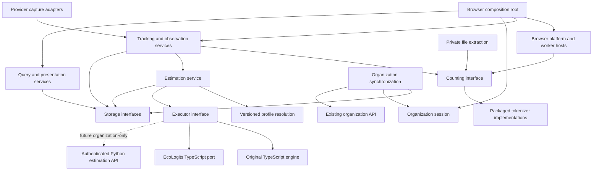

# Modular extension and parallel EcoLogits engine: implementation plan

**22 September 2026 superseding decision:** Current extension builds use EcoLogits only. Original-default builds and product engine selection are retired. Original code, historical identities, archived research and explicit research comparisons remain available. Earlier dual-default build and picker requirements below are historical; see the [current contract amendment](CONTRACTS.md) and [research archive](../research/archive/original-method/README.md).

Date: 14 September 2026. Planning baseline: working tree based on `15515fd`, including existing uncommitted history, presentation and methodology changes. Planning only: no product implementation is claimed. Read with [the architecture assessment](../research/ARCHITECTURE-MODULARITY-2026-09-14.md), [the current-code comparison](../research/ECOLOGITS-CODE-COMPARISON-2026-09-14.md), [the acceptance matrix](MODULAR-EXTENSION-ECOLOGITS-ACCEPTANCE.md), [existing contracts](CONTRACTS.md) and [the main plan](../../IMPLEMENTATION-PLAN.md).

Status: implementation authorized and in progress. This document and its acceptance matrix specify the complete required behavior; execution and independent evidence are tracked in [the refinement record](../release/MODULAR-REFINEMENT-STATUS.md). Unimplemented requirements are not completion claims. Later owner answers about Advanced settings supersede the initial developer-only selector proposal.

## 1. Objective and scope

Restructure the application around explicit, replaceable capture, token-counting, observation, estimation, local-storage, organization and presentation boundaries. Preserve the existing estimation engine and add a separately versioned, faithful TypeScript port of EcoLogits. A developer build setting supplies the default; a user may override it in the extension dashboard's Advanced settings. Changing the effective method automatically recalculates available saved numerical observations into a new default view while retaining original results.

The extension remains TypeScript/JavaScript. Do not ship Python, Pyodide, a native companion, a local HTTP daemon or a new remote dependency. Keep WXT, React, IndexedDB, FastAPI and PostgreSQL. Modular code does not require separate processes, microservices, a generic plugin framework or a general event bus.

Current implementation scope:

- Restructure the extension and shared packages; preserve extraction/counting behavior and explicitly tracked existing gaps.
- Preserve the original engine, its immutable baseline and replay behavior.
- Port the selected upstream calculation surface and add local integration under developer build configuration.
- Make contracts, result views, persistence, aggregation and the existing organization backend compatible with the added engine.
- Define and test the executor boundary needed by a future organization estimation API, using an in-process fake remote executor only.
- Upgrade tests, reproducible builds, documentation and license/source inventories.

Future scope, not silently included:

- Improving provider extraction accuracy or adding new provider traffic coverage.
- Improving/calibrating tokenizer accuracy or introducing new counting implementations.
- New image, audio, video or tool capture merely because an engine can calculate a corresponding input.
- Activating remote per-request estimation, deploying a server, publishing extension packages, changing billing or enrollment policy.
- Empirical power-meter calibration, paid model calls, private captures or additional telemetry.

Engine parity means fidelity to a pinned implementation for declared inputs. It does not establish accurate physical measurements of closed consumer products or guarantee the absence of software defects.

## 2. Confirmed decisions

### Confirmed by the current request

| ID | Decision |
| --- | --- |
| D01 | Keep the original estimator and add EcoLogits as a parallel implementation. Do not replace or delete the original formula. |
| D02 | The developer/build configuration supplies the default engine. The dashboard's Advanced settings includes an engine picker; a supported saved user choice overrides the build default for that installation. |
| D03 | Original and EcoLogits builds must both be reproducible and testable. Until a separate shipping decision, keep the original build as the default. |
| D04 | Personal mode continues local calculation and local storage without account or backend requirements. |
| D05 | Future organization-connected clients may delegate calculation to a Python backend API. Prepare the boundary now; activation is future work. |
| D06 | Extraction, tokenization, storage and formulas must have independently changeable implementations behind stable contracts. Genuine contract changes can still require coordinated updates. |
| D07 | The owner has now authorized implementation and independent verification of the complete plan in the current worktree, with no push to main. |
| D08 | Reuse EcoLogits' complete relevant model/data library through deterministic imports. Make subsequent catalog and release adoption a repeatable workflow; keep local policy overrides separate from upstream records. |
| D09 | Preserve applicable EcoLogits license/source obligations and give visible project and scholarly credit. Recheck licenses, notices and citation metadata with every adopted update. |

### Owner answers, including later corrections

| ID | Topic | Confirmed answer |
| --- | --- | --- |
| Q1 | Headline scope | Operational-only headlines; preserve full upstream usage, embodied and total results in the engine output. |
| Q2 | Engine/default change and existing records | Recalculate available saved observations and show the recalculated view by default, retaining originals. |
| Q3 | Missing upstream model | Developer-configurable same-provider fallback; also support choosing the preserved original engine as the fallback. |
| Q4 | Port coverage | Port and verify text and video cores. Only supported observed workloads are activated in the extension. |
| Q5 | User selection | Add the new engine to a user-facing picker in dashboard Advanced settings. The developer chooses the default; the user's selection controls calculations for that installation. |
| Q6 | Meaning of highest provider model | Use an explicitly developer-configured flagship per provider, with override support. Do not infer the choice from highest electricity, model-name sorting or newest release. |
| Q7 | Developer comparison | Offline numeric/synthetic-fixture comparison command and report. No separate production comparison-mode switch or development screen is required. This does not revoke Q5's Advanced settings engine picker. |

The preference applies to the current extension installation/browser profile and all sites it tracks. An extension-only application cannot silently synchronize settings across unrelated browser profiles on the same physical computer. All original numerical records/results remain subject to existing erasure and retention rules. No unanswered behavior question remains for this plan; provider mapping data and platform evidence are implementation deliverables, not reasons to invent values.

## 3. Source findings that constrain implementation

1. Shared packages already exist: `capture-core`, `adapters`, `tokenizers`, `file-text`, `contracts`, `estimator`, `ledger` and `ui`. Keep them unless a specific boundary benefits from a new package.
2. `Coordinator` handles tracking, identity, uploads, counting, estimation, context, display and query orchestration. It constructs `CompanyClient`, `HistoryService`, `MethodService` and `RecordedThreads`, so dependencies are only partly injectable.
3. Estimation is invoked in live capture, historical imports, company reconciliation and method recalculation. Change all these paths, not just the main live call.
4. `countText` already exposes job/revision/profile metadata; `CountHost` and `platform.countLocally` weaken this to `Promise<any>`. The current worker path does not convey explicit profile selection end to end.
5. The original estimator uses `decimal.js` precision 48 and half-even rounding; base-unit serialization is 18 decimal places. It evaluates four reference profiles, usually selecting Command A, using a fixed environmental scenario and an uncapped latency regression. These are deliberate legacy semantics to freeze.
6. Legacy method ID is `ecologits-reference-2026-09-10-v1`, equation ID `ecologits-output-v1`. The reviewed canonical bundle hash is `7684a7960e2b21ae5082a23c50052563447bbe588d32ea052b79373525783bc9`; independently verify it when freezing the implementation baseline.
7. `BundleSchema` accepts one scalar profile structure, 16-bit precision, and only the old/test equation IDs. `approveBundle` rejects total parameter counts above 200 billion. Do not loosen these legacy rules to accommodate new EcoLogits model ranges.
8. `Metric.scenario_low` and `scenario_high` currently have type `null`. History-resource and server-summary shapes are also scalar. A full upstream result cannot fit without a new result schema.
9. Historical capture stamps the baseline ID/hash, historical estimation accepts only that baseline, and server historical ingestion explicitly checks `ecologits-output-v1`. These are separate migration points.
10. Organization synchronization recomputes canonical records locally, while the Python server independently recomputes its accepted method. A new extension engine alone would leave connected clients incompatible.
11. Existing parity tests compare our TypeScript code against our own Python reference. This is not a substitute for tests against the actual upstream package.
12. Current counters are decimal strings up to signed 64-bit maximum, beyond JavaScript's exact-integer range. The new binary64 calculation core requires an explicit numeric-admission policy.
13. The ledger owns IndexedDB version 11 and multiple guarded, atomic record/outbox/derived/history operations. Splitting files must preserve these operations as one transaction where required.
14. Browser packages currently use output paths and archive names that do not identify the engine. Builds for two defaults could overwrite each other unless packaging is updated.
15. Current consumer-model recognition, protocol aliases, context budgets and tokenizer bindings are distributed across contracts and extension files. Recognition is not tokenizer or energy calibration.
16. Existing docs contain historical version numbers and earlier support statements. Derive actual baseline schema/migration versions from source when implementing and qualify documentation rather than copying stale assertions.

## 4. Module architecture

### 4.1 Dependency direction



The mathematical engines have no storage, browser, network, user/tenant, DOM or wall-clock dependency. Calculation inputs are explicit values. The application service resolves scopes, methods, profiles, caching and storage. Do not conflate the pure engine with an application service just because both are called estimation.

### 4.2 Responsibilities and proposed locations

| Module | Responsibility | Proposed implementation |
| --- | --- | --- |
| Contracts | Typed internal messages; numeric observations; engine inputs/results; schema unions | Preserve `packages/contracts`; split domain files and generate JSON Schema/Python validators. |
| Capture | Browser observation lifecycle and forwarding; no token/formula arithmetic | Existing extension capture runtime split by lifecycle; use existing provider adapters. |
| Provider adapters | Provider-specific dispatch, frames, routes, history, upload and selected-output interpretation | Keep `packages/adapters` and focused extension platform/placement adapters. |
| Counting | Select a packaged tokenizer and return scoped numeric evidence | Keep `packages/tokenizers`; add typed engine registry and worker request/response boundary. |
| File extraction | Extract accessible bytes and count transient text in one private worker | Keep `packages/file-text`; inject counting implementation internally. |
| Observation assembly | Requests, attempts, revisions, deduplication, branch/context evidence, partial states | Extract from `Coordinator.process` into `apps/extension/lib/tracking/`. |
| Estimation service | Resolve immutable method/input, execute, map results, cache and persist | `apps/extension/lib/estimation/` with small portable adapters in `packages/estimator`. |
| Original engine | Existing math/data and legacy interpretation | Retain current implementation; expose through an adapter without changing numerical behavior. |
| EcoLogits core | Ported pure upstream calculations and required repositories/helpers | New `packages/ecologits-core` with MPL-covered code clearly separated. |
| Profiles | Model aliases, tokenizer binding, estimation binding, environment and capacity evidence | A reviewed, versioned data source with independently qualified bindings and generated allowed lists. |
| Storage | Typed repositories and atomic commit unit, IndexedDB details/migrations | Split `packages/ledger` internally; retain one transactional database. |
| Organization | Session/enrollment, transport, live/history outboxes, reconciliation, deletion | Split `company.ts` and maintenance callbacks into `lib/organization/`. |
| Queries/UI | Canonical local/company view models, uncertainty projection, transport and presentation | Typed client/hooks, shared presenters and small React/in-page components. |
| Composition/platform | Construct implementations, browser permissions, worker lifecycle, alarms and messaging | Thin startup in entrypoints; platform modules retain browser-specific behavior. |

Favor explicit narrow interfaces and constructor/factory injection. Do not use service locators, mutable browser globals, arbitrary runtime imports or an event bus to hide dependencies. New files do not need separate npm packages unless they are portable, license-isolated or independently reused.

### 4.3 Core interfaces

Define strict schemas plus inferred types for:

- `CaptureEnvelope`: provider capability/version, source identity, revision, lifecycle, bounded transient payload. Not a persistence DTO.
- `CountRequest/CountResponse`: job/revision, allowed text fields, selected tokenizer profile/version; numeric counts, evidence, assets, completeness and sanitized failures. Cancellation is explicit.
- `ObservationAssembler`: capture plus counting result plus prior numeric lineage produces validated observation mutations. It has no HTTP or formula knowledge.
- `ResolvedMethod`: engine implementation/version, immutable method/profile/environment hashes, accepted data, applicability, scope policy and numeric-domain policy.
- `CalculationInput`: discriminated text/video workload, numeric evidence and required model/environment parameters. It contains no prompt, answer, file bytes, title, filename, raw provider IDs or credentials.
- `CalculationCore`: synchronous pure mathematical functions. This is the unit tested against upstream Python.
- `EstimateExecutor.execute`: asynchronous boundary taking a pinned input/method and cancellation signal. Initial implementations invoke local engines; a future remote executor uses the same semantic envelope.
- `EstimationService`: live/historical/recalculation entrypoints, input preparation, method resolution, product result mapping, caching, persistence and publication guards.
- Storage views: observations, estimates, history, outbox, methods, settings/ownership and erasure. Share a transaction/unit-of-work implementation for changes that must commit together.
- Organization session/transport interfaces: authenticated principal and narrow request operations. The synchronization service decides which numeric observations are eligible to send.
- Typed extension action map: specific request/response pairs for UI, counting and background commands. Runtime validation supplements, not replaces, sender/origin/frame/permission checks.

Each boundary must define unavailable, unsupported, cancelled, stale, partial and failed outcomes. Token counting and numeric recording remain possible when environmental estimation is unsupported.

Live input preparation needs the validated request and attempt together, because `AttemptObservation` does not independently contain every site/context field needed for provider resolution. Resolve them through the same scope and revision guard. The new calculation-input hash binds request and attempt dependency hashes plus model-mapping/method/environment policy; do not cache only by token count or attempt ID. Canonical server reconciliation must obtain the corresponding authorized numeric request when required, or leave estimation pending. Historical inputs bind the historical record hash and its own evidence, without inventing a live request. The legacy adapter continues accepting its original input surface internally.

## 5. Developer build selection and engine identity

### 5.1 Developer configuration

Add one reviewed source configuration, for example `config/estimation.build.json`, with `default_engine` equal to `original` or `ecologits`, and both engines available. Include the versioned EcoLogits fallback policy in the configuration's resolved manifest. Optional build-command overrides must use the same strict validator and be written into the build provenance. Never infer an engine from an installed dependency, environment typo, user agent or current server response. Invalid configuration fails the build.

Provide explicit commands such as `build:original` and `build:ecologits`, each supporting Chrome, Edge and Firefox. These are proposed command names and select the shipped default, not remove the other engine. The normal build remains original until the owner chooses otherwise.

Add one Advanced settings preference with choices `Follow build default`, `Original calculation` and `EcoLogits`. Persist a validated installation-level preference and selection revision. Explicit original/EcoLogits choice wins over subsequent build-default changes; follow-default resolves to the current packaged default. Show the effective engine and the consequences for recalculation before applying the ordinary settings change. Do not expose profile parameters, fallback editing or a comparison laboratory to end users.

Reorganize existing method/result controls rather than create competing authorities: the Advanced setting selects the engine for new work and the default recalculated view; an original/recalculated view control can inspect retained originals without changing that engine preference. Technical method catalogs do not silently override an explicit user choice. If a preference references an unavailable engine, show a recoverable unavailable state rather than silently choosing another formula.

The effective selection applies to newly admitted observation families. Store the resolved method ID/hash at first admission. A stream continuing across service-worker restart, user selection or extension update retains its pinned original method. Refining an existing historical message retains its original method. Separately, a changed effective method schedules automatic recalculation for saved observations according to section 9.1; it never mutates their original method/result.

### 5.2 Distinguish identities

| Identity | Purpose |
| --- | --- |
| Requested/effective engine IDs | User/build-selected implementation family and the actual engine used if a configured missing-model fallback invokes original. |
| Engine version/source commit | Exact executable implementation and upstream provenance. |
| Method/policy ID/hash | Calculation behavior plus profile/environment/scope/fallback policy and immutable inputs. Existing legacy ID/hash stay unchanged. A composite EcoLogits policy can have a preserved-original effective child method. |
| Profile/data version/hash | Exact model assumptions, provider configurations and factor data. |
| Result-schema version | Representation of values, ranges, coverage and phases. |
| Observation revision/hash | Numerical evidence being estimated. |
| Execution origin | Local or future organization remote execution; not a different methodology by itself. |
| Build fingerprint | Browser target, source/dependency hashes, active default and included compatibility engines. |

Suggested new IDs are `ecologits-0.11.1-port-v1` for the raw implementation and a separate product method ID encoding the approved scope/profile policy. Final IDs must be immutable and validated consistently in Python/TypeScript. Do not reuse the old method ID for numerically different behavior.

### 5.3 Compatibility code and artifacts

Preserve both engines in source and package both selectable implementations and required historical compatibility implementations. Load code/data lazily where useful. Only the effective developer/user choice is the default for new observations. Do not optimize away an engine that is offered by the Advanced selector or required by a configured fallback. Omitting a selectable engine is outside this plan.

Separate browser build/output/archive directories by engine and browser. Add default engine, method/hash, supported result schemas, compatible engines and upstream data hashes to release manifests, source archives, SBOMs and input fingerprints. Validate public download copies against the selected shipping manifest to prevent accidental replacement with the other variant. Keep stable extension IDs for in-place upgrades; distinct IDs are permitted only in explicitly separate development profiles for side-by-side QA.

Signed data-only updates may update profiles within an engine's supported schema. They cannot change the build default, introduce a new executable engine, supply formula strings, override historical hashes or download code. New executable logic requires an ordinary packaged release.

## 6. Preserve the original engine

Before refactoring, freeze a synthetic baseline corpus covering its outputs, serialization, profile winners, warnings/reasons, unknown values and history behavior. Verify the baseline file/hash and exact current behavior against the current working tree, not stale documentation or an earlier commit that would lose current refinements.

Preserve:

- Current Decimal configuration and 18-place serialization.
- Current four-member cohort, eligibility and tie-breaking per existing live/history paths.
- Fixed baseline environmental assumptions and existing water-total unavailability.
- Current execution/output eligibility, unsupported media references and hidden-work exclusions.
- Current legacy method/bundle/result schemas and hashes.
- Historical lookup, original/recalculated lineage, server recomputation and export behavior.

Wrap existing functions behind the new interface before moving their internals. Do not replace legacy Decimal arithmetic with JavaScript numbers to share helpers with the new port. Do not fix an unrelated legacy defect inside a behavior-preserving refactor. Document it and handle it in a separately versioned change. Equivalent legacy numerical records must keep byte-equivalent canonical outputs where that is the existing contract.

Old methods remain available for their recorded data. An effective engine/method change creates a new automatically recalculated default view while preserving originals; it does not permit overwriting original results or rehashing old observations. Deletion/retention can still remove records according to existing policy.

## 7. EcoLogits port specification

### 7.1 Pin and inventory

Initial target: EcoLogits 0.11.1, immutable commit `886d1ebfadb51a2d6407fcea6d9778c997c85c35`. Verify tag-to-commit and PyPI artifact hashes during implementation. Do not mix `main`, `/latest/` documentation and release data in a single reference. The live website is useful explanatory material; executable fidelity is assessed against pinned source and independently executed Python.

Inventory these files and their transitive calculation dependencies:

| Upstream surface | Treatment |
| --- | --- |
| `impacts/llm.py` | Port intermediate and final LLM functions, defaults and range propagation. |
| `impacts/video.py`, `estimations/video.py` | Port and verify both; no automatic runtime video activation. |
| `utils/range_value.py`, `impacts/modeling.py`, `exceptions.py` | Port observable value/phase/unit/error semantics used by supported functions. |
| `impacts/dag.py` | Preserve calculation order, dependencies and explicit overrides. An explicit typed evaluation graph is acceptable if outputs/intermediates prove equivalence; do not recreate Python reflection unnecessarily. |
| `model_repository.py`, `electricity_mix_repository.py` | Immutable loaders, aliases, duplicate/unknown handling, values, sources and warning semantics. |
| `tracers/utils.py` | Port the numeric lookup-to-calculation bridge and provider defaults; exclude network tracing. |
| `data/models.json`, `data/electricity_mixes.json`, `data/video_models.json` | Pin exact bytes and transformed-data hashes. Preserve per-field units and source metadata. |
| `status_messages.py` | Preserve semantic codes. Sanitize messages before product exposure; no captured text in diagnostics. |
| Provider SDK wrappers, OpenTelemetry, hosted FastAPI server | Do not port/import. Our capture/transport remains independent. |

No official generalized image-generation energy core is present in this release. Images are a separate component (2.907 Wh per image times the provider PUE since 3 October 2026; the earlier ML.ENERGY image-reference pathway was removed on 20 October 2026 because the ML.ENERGY leaderboard repository it came from has no licence); do not silently route images or documents through text/video formulas. Full upstream output includes electricity, GWP, ADPe, primary energy and water, with usage and embodied phases where available. Training and embodied water remain unsupported.

Import the full upstream catalog through deterministic tooling, keeping the unchanged upstream snapshot, generated normalized records and our mapping/fallback overlays separate. Do not populate the port by manually selecting or transcribing only the original engine's reference models. The [upstream maintenance and attribution specification](ECOLOGITS-UPSTREAM-MAINTENANCE.md) defines the lock manifest, update commands, change classification, release adoption and license gates.

### 7.2 Numerical fidelity

Use JavaScript binary64 numbers inside the EcoLogits core to match Python float arithmetic. Preserve operation order, units and default selection. Keep counters as exact strings outside that core. Admit only safely representable finite workload integers to the new core; otherwise record tokens and an explicit engine numeric-domain failure. Never silently round an arbitrary signed-64-bit counter through `Number(...)`. The legacy engine keeps its existing wider Decimal domain.

Reference comparisons require exact categorical/structural equality and a predefined per-unit absolute/relative numeric tolerance. Start with relative tolerance `1e-10` and an absolute tolerance table appropriate to each unit and near-zero domain, fixed before expected-output generation; tighten where measured cross-runtime agreement supports it. Do not increase tolerance merely to hide a discrepancy. GPU-count branches, enum choices, warnings, null/error outcomes and schema identities must match exactly. Test near rounding and branch boundaries explicitly.

Do not use cross-runtime equality of floating-result hashes as a proof of identical computation. Input/method/profile hashes must match exactly. Each concrete serialized result has its own canonical hash; numerical equivalence is evaluated separately. Define one deterministic decimal-string serialization with finite values and bounded length for new results; preserve legacy serialization untouched. Store all range endpoints, not just a displayed midpoint.

Key LLM semantics to preserve:

- Dense versus MoE; scalar versus ranged total/active counts; upstream paired-endpoint evaluation, not an invented Cartesian uncertainty model.
- Memory multiplier, precision, GPU memory and rounding to allocated GPU counts, including exact threshold behavior.
- Per-token GPU regression and host-power allocation; no extra division by batch size or duplicate PUE application.
- TPS/TTFT overrides, regression fallback, measured-duration cap and absent-duration behavior. Seconds, hours, Wh and kWh conversions must be explicit.
- Provider default geography/PUE/WUE, explicit world zone, missing/invalid zone and electricity-data warnings.
- Usage, embodied and total GWP/ADPe/PE; usage-only WCF.
- Unit-aware impact addition and warnings/errors returned independently of log suppression.

### 7.3 Video semantics

- Port named/explicit resolution parsing, normalization, duration-to-frame conversion, all regression coefficients, hardware selection and audio behavior.
- For positive duration, source frame count is `int(duration * 24 + 1)`; preserve boundary rounding. Product admission rejects invalid dimensions/durations before invoking the engine.
- Source hardware data uses watts; the high-level wrapper divides by 1000 before its kW-based energy kernel. The kernel docstring has a conflicting watts description. Lock the implementation behavior in fixtures and record the discrepancy.
- Omitted high-level location uses `WOR`; explicit `None` selects the provider default. Do not collapse missing/null semantics in translation.
- The default regression already includes audio; with audio enabled the wrapper uses multiplier 1.0. Without audio it uses the model's stored factor.
- Video allocates full selected machine power, unlike LLM batching/allocation. Keep the two models distinct.
- Preserve power approximation intervals and hardware/accelerator embodied allocation. Do not describe source power percentiles as a confidence interval for a user's complete generation.
- The high-level video helper does not expose every low-level override. Test both surfaces separately rather than adding behavior under an existing method identity.
- Keep the video path dormant for production observations until a later capture/schema/applicability change supplies reliable inputs. Unit-testable code is not a claim of supported website video tracking.

### 7.4 Source defects and validation boundaries

Faithful porting is not permission to publish impossible results. Maintain two explicit layers: source-compatible behavior for the admitted reference domain, and a strict product admission/result validator.

Create a discrepancy register with fixture ID, source revision, observed Python behavior, candidate TypeScript behavior, affected domain, disposition and provenance. Initial items to investigate include:

- `Model.from_json` checks singular `source` before reading `sources` in the pinned code. Preserve raw dataset provenance separately so the product cannot lose it.
- `RangeValue` implements endpoint arithmetic and nonstandard comparison/reverse-division behavior. Do not substitute a general interval library and assume equivalence. Test operations actually used and reject unsupported sign/division domains at product admission.
- Missing/null/default distinctions in provider and video location handling.
- Video power units in docstrings versus wrapper code.
- Nonfinite, negative or reversed-range results and input coercion differences between Python/Pydantic and JavaScript.

Do not silently correct upstream numeric behavior and still claim an exact port of the same method. If a relevant upstream bug is confirmed, either restrict the affected domain with an explicit unavailable reason or define a separately versioned correction with separate fixtures. Report upstream issues only with separate authorization to send a message.

## 8. Model profiles, workloads and product scope

### 8.1 Model resolution

Keep website model identity distinct from an upstream API-provider/model lookup. Use an explicitly reviewed mapping record containing observed canonical ID, source of identification, upstream model/profile ID, mapping evidence, applicability and review date. A similar name or router selection does not establish the actual executing model. Perplexity and opaque routing require explicit compatible profiles or fallback; do not pretend that changing an API provider label identifies the real hosting configuration.

Model catalog identity, tokenizer mapping, architecture, deployment timing and context-budget evidence are independently versioned. Data records may update supported profiles but cannot load executable tokenizers or change archived schemas. Generated allowlists must preserve strict privacy validation and historical version compatibility.

Matched upstream profiles remain assumption-based where architecture is undisclosed. Custom profiles need sourced or explicitly assumed total/active parameter ranges, architecture, optional deployment statistics, provider/environment context, scope and warnings. Do not infer energy solely from model price, generation speed or release number.

For missing models, use a developer-configured flagship from the same underlying provider when that provider identity is sufficiently established. The default is an explicit mapping, not a runtime ranking. OpenAI's mapping may name `gpt-5.5-pro` if that exact pinned record passes catalog/applicability validation; Anthropic and other providers require their own reviewed choices. These are assumptions/proxies, not claims about the absent model's actual parameter count. Do not manufacture a flagship for a provider missing from the upstream catalog.

Resolve precedence deterministically: an explicit observed-model override first; otherwise an eligible reviewed direct mapping; otherwise the identified provider's configured fallback; otherwise the explicit unknown-provider policy. A configured flagship must not replace an available direct mapping merely because the provider has a fallback entry. Supported policies are `upstream_provider_flagship`, `original_engine` and `unavailable`; an exact override may also reference a specifically reviewed upstream profile. Validate all referenced profiles at build/data admission, match modality/provider, reject cycles, and never choose another provider implicitly. Runtime uncertainty about the underlying provider in a router goes to the explicit unknown-provider policy.

The versioned developer configuration should make these choices visible, for example:

```json
{
  "default_engine": "original",
  "available_engines": ["original", "ecologits"],
  "ecologits_fallback": {
    "policy_version": "1",
    "provider_defaults": {
      "openai": {"strategy": "upstream_provider_flagship", "profile_id": "reviewed-openai-flagship"},
      "anthropic": {"strategy": "upstream_provider_flagship", "profile_id": "reviewed-anthropic-flagship"}
    },
    "model_overrides": {},
    "unknown_provider": {"strategy": "unavailable"}
  }
}
```

The `reviewed-*` IDs above illustrate internal references, not runnable or invented model records. Implementation replaces them with validated profiles and supplies an explicit entry for every supported provider/unknown-provider case. Changing a provider entry to `{"strategy":"original_engine"}` enables the requested original-formula fallback. Require a complete, validated shipping configuration; do not let omitted entries accidentally choose a different provider. The offline comparison command supplies the evidence for the developer's final profile choices.

An original-engine fallback invokes the preserved original engine with its existing own cohort/environment semantics. It does not change that engine's coefficients or pretend those assumptions are a same-provider EcoLogits flagship. Record requested engine, effective engine, parent fallback policy, effective child method ID/hash, selected profile and reason. To avoid method spoofing or stale cache reuse, the parent method/policy hash includes the fallback configuration and all child method/data hashes. The original raw child output remains unchanged. Never recurse into the EcoLogits policy when original is selected as a fallback.

Keep original-engine direct execution entirely unaffected by the EcoLogits fallback configuration. A changed flagship or fallback policy creates a new immutable effective method/policy and participates in automatic view recalculation when it becomes the selected default. No global highest-model or highest-electricity selection is added unless requested in a later policy version.

### 8.2 Observed workload

Prefer a verified, semantically compatible provider-reported output total when one exists; otherwise use the existing observed-answer count. Preserve counting evidence and coverage. Do not add visible thinking to a total that might already include it or invent hidden reasoning/cache/tool multipliers. No new input-length term is introduced by this port.

The current extension does not provide validated server-generation latency. Existing wall-clock record timestamps can include processing/queue delays. For current EcoLogits product inputs use absent measured latency and the explicit profile/regression strategy; do not fabricate a measured cap from historical timestamps. The raw port still supports tested duration caps. A future extractor may add a versioned measured-timing field with its evidence and domain.

Cancelled or failed attempts with observed positive output may have a useful partial estimate. Zero visible output after execution does not establish zero energy. Distinguish true not-applicable/no-execution from executed-but-unobserved work. Preserve token records if estimation fails.

Historical responses provide a partial output surrogate and unknown original execution timing. Prompt messages are not output generations. Preserve date basis, observed-at time, branches, selected-output evidence and live/history matching. Reopening, reimport and synchronization are not new AI executions.

### 8.3 Raw results versus product headline

Retain raw upstream metric/phase/range outputs and their provenance in the new engine result. A separate product projection preserves operational-only headlines and existing boundary rules. Raw source parity must not be confused with permission to put every raw metric into a headline total.

**Owner amendment, 16 September 2026:** use the upstream WCF directly as displayed water consumption under `upstream-wcf-1`. Do not recalculate direct/electricity-supply components, suppress a successful WCF on source-category grounds, or add water-source labels to its display. Preserve the raw output and its ranges. True missing inputs and upstream failures remain unavailable. Existing originals remain unchanged and the new policy has its own method identity. Browser/user/company IP cannot choose a data-center region.

Map headline metrics from the upstream usage phase and store embodied/total outputs separately. Any future decision to include hardware requires a new explicit product-scope identity and grouping/label review; it is not an engine-switch side effect.

## 9. Result schemas, aggregation and history

Create a strict versioned union retaining all old observation, result, bundle and history schemas. Do not edit archived 1.1/1.2 observation validators or legacy numerical-result meaning. Use a new engine-result schema for data not representable today. Extend observation schemas only if genuinely new measured inputs are added; existing method IDs and stored model/count evidence may suffice for the first text integration.

The new result must include:

- Record family/ID/revision and immutable observation hash.
- Engine/source/method/profile/environment/product-scope identities and hashes.
- Execution origin, input hash, state, sanitized failure, eligibility and fallback evidence.
- Raw upstream metric values as scalar or min/max approximation interval, each with unit, phase and provenance.
- Product-selected metrics, including unavailable values and reasons, distinct from raw outputs.
- Interval kind (`upstream_approximation`, explicit scenario, or other supported form), dependence/grouping metadata, and optional labeled midpoint.
- Original/recalculated lineage, included/missing components, validation state and source dates.

Use a discriminated raw-result union: an original-engine fallback preserves the legacy result, while an upstream execution preserves the EcoLogits result. Do not manufacture upstream-only metrics/phases for a legacy fallback. Product metrics explicitly state requested/effective engine and the parent policy; display and grouping must not misleadingly attribute original-engine arithmetic to EcoLogits.

Current displays can use a labeled midpoint where their compact layout requires one, provided the actual interval remains stored and accessible and the midpoint is not described as a measured or expected mean. The Advanced engine selector and result-view controls must preserve method provenance and uncertainty disclosures.

Aggregate only compatible units, phases, workload scopes, gas boundaries, water categories, counting profiles and selected calculation views. Do not add both original and recalculated values, both local and canonical server totals, or usage plus an already-inclusive total. Keep method-group details even when compatible central values are combined.

Preserve intervals by kind. Do not sum unrelated percentiles or call summed endpoints a confidence interval. Aggregate ranges only where the input/dependence metadata defines compatible coherent scenarios; otherwise retain component/group intervals and report aggregate interval unavailable. Midpoint sums, if shown, must remain labeled midpoint-based estimates rather than expected consumption. No square-root-of-count reduction of shared model uncertainty.

Do not overwrite original results when the effective method changes. Automatically create a recalculated default view, preserving originals. Unsupported old engine code means unavailable recalculation, not deleted results or invented conversion. Historical refinements and matched live records must continue deduplicating independently of the active build default.

### 9.1 Automatic recalculation and view switching

Trigger when the resolved effective method/policy changes because of a user engine selection or an applicable developer/data update. Do not trigger when a build-default change is masked by an unchanged explicit user preference. Persist a selection revision, target method/hash, scope, job ID and bounded cursor before processing. The operation is idempotent across reloads and background restarts.

Recalculate available numeric observations only. Stored text is not available for retokenization; retain the recorded tokenizer evidence and do not claim a new engine improves those counts. Missing timing/model/profile evidence yields a scoped unavailable/partial result, not fabricated inputs. A user choosing another engine while a job runs supersedes the display generation; cancelled/superseded work cannot publish as the new default.

Process bounded pages, yielding between pages and preserving concurrent capture. During recalculation show a clear updating/pending state with original or last completed results explicitly labeled; do not combine a partial new-engine result set into a seemingly complete new default. Promote the view through an atomic selection/cursor check only after all records in its declared snapshot/revision set have terminal calculated/unavailable outcomes. Newly changed observations require incremental completion or an explicit pending indicator; a completed cursor is not proof that every later revision was estimated. Expose processed/remaining counts only where their denominator is known.

For personal mode, use local repositories and a persisted local job. For enrolled My usage, use authorized self-scope backend recalculation where canonical server observations are needed; local unsynced observations remain a separate compatible contribution until reconciliation. Do not fetch restricted coworker observations or reinterpret a whole server summary locally. An ordinary user's engine preference must not trigger organization-wide recalculation or change another installation's preference. Company totals remain canonical with method breakdowns unless an authorized existing admin operation requests a company recalculation. Explain that scope in Advanced settings.

Selections and their local view jobs are installation-scoped. Shared server recalculation results may be reusable by method/input identity but do not set another client's preferred view. Disconnect/scope switch invalidates pending publication; deletion invalidates/reconciles jobs and prevents resurrection. Keep an inspect-original action, and show failures with retry/resume rather than silently showing stale totals as recalculated.

## 10. Storage and migration

Introduce typed repositories over the current IndexedDB implementation. Keep an internal transaction service for observation, estimate, outbox, scope, erasure and derived-view mutations. Do not make each repository commit independently.

Use additive schema migrations from the actual implementation head. Preserve old records and hashes byte-for-byte unless an existing correction operation explicitly creates a new revision. New result fields can live in a new store/envelope where that simplifies old-reader compatibility. Build migration fixtures from populated pre-refactor databases, not only empty databases.

Migrations and rollups must handle quota errors, interrupted upgrades, old/new tabs, browser shutdown, deleted records, pending outboxes, signed method catalogs, mixed schema versions and large histories. An unsupported downgrade must visibly refuse writing rather than silently rebuilding or deleting data. Do not promise arbitrary old binary compatibility. Rollback artifacts should be the refactored, new-schema-capable original-engine build.

Erase derived estimates, caches, raw-result envelopes and remote pending jobs with their observation families. Preserve erasure markers and anti-resurrection guards. Personal records remain local; connecting an organization never backfills them. Method/profile updates invalidate only matching caches and never restore erased history.

## 11. Existing organization backend and future remote execution

### 11.1 Compatibility needed in this implementation

Keep the current organization service/API architecture. Add validators, engine/method resolution, new result serialization and compatible rollup/export handling so both builds work when enrolled. Preserve server-authoritative recomputation; do not trust client-supplied environmental totals or parameter vectors merely because their units look valid.

Retain the legacy Python reference for old methods. For the new method, use the pinned upstream EcoLogits Python package behind a thin equivalent product adapter, including identical model mappings, numeric-admission rules, fallback policy and product scope. Keep raw-source outputs distinct from product projection. Validate TypeScript-port/Python-native equivalence. These are internal existing-ingestion calculations, not activation of a new remote estimator API for the extension.

Update historical ingestion, current/recalculated views, method inventory and exports, not only live ingestion. Servers advertise accepted schemas/methods. An old server may accept numeric observations with an unsupported live method only where the existing explicit pending contract allows it; otherwise connection/sync reports incompatibility and preserves local data. For history, add explicit capability negotiation and pending behavior or block that upload with a recoverable reason. Never alter the proposed method to make an old server accept a batch.

### 11.2 Future API boundary, specified but not activated

The executor interface must support a future authenticated `RemoteEstimateExecutor`. A proposed endpoint is `/v1/estimates`; reserve semantics, not a public production commitment. It accepts validated numerical observations or authorized observation references, required method/hash, observation revision/hash, input hash and idempotency identity. The server resolves trusted profile/environment data and derives tenant/user/install identity from authentication.

The response includes result schema, accepted identities/hashes, execution origin, source version, state and numerical result. Verify the response against the submitted observation and currently active scope before storing/publishing it. Treat network success separately from calculation success. Never execute code or accept an arbitrary external URL from a response/profile.

Required future behaviors:

- Personal or disconnected mode never calls the endpoint.
- Remote execution requires explicit organization capability, disclosure/authorization and exact supported method agreement.
- A timeout means unknown remote completion, not zero or a new AI request. Retries use the same idempotency key for identical work.
- Offline fallback can use a packaged local executor only for the exact same accepted method/profile/environment hash. Otherwise record a pending estimate with tokens intact; never silently substitute the other engine.
- Local and remote results for one observation/method are alternative executions of one estimate, not additive usage. Server canonical reconciliation follows one explicit authority rule.
- Reject late responses after scope switch, disconnect, revision change, erasure or method change. Propagate cancellation and bound queues/retries.
- Handle 401/session expiry, 403/revocation, 409/method or revision conflict, 413/size, 422/invalid input, 429/backoff and 5xx/unavailable. Keep credentials in the session module.
- Enforce per-tenant authorization, bounded payloads/work, valid model domains and no raw content/logging. A custom server response is not trusted solely because an employee connected to its origin.

Now: create the interface, metadata and fake-transport tests. Do not implement a live endpoint, remote toggle, public EcoLogits API dependency or new network permission in this task's implementation scope.

## 12. Capture/counting upgrade readiness

Preserve current extraction and token numbers during structural changes. Baseline known extraction gaps and unverified tokenizer mappings remain visible. Do not rename a refactor into an accuracy improvement.

Provider adapters expose capabilities, version, accepted routes/protocols, interpretation and diagnostics. Keep snapshots, patch replacement semantics, streaming assembly, stop/cancel identity, upload association and selected branch logic inside the appropriate provider/tracking modules. Keep browser frame/origin permissions in platform admission. A future provider implementation replaces its adapter and fixtures through a registry, not changes to storage/estimation code unless its output contract adds a new observation.

Tokenizer implementations expose counting, supported encodings/profiles, asset hashes, special-token policy, bounds and evidence. Profile selection is explicit throughout worker requests, file counting and historical counting. All implementations run from packaged code/assets. Do not add remote count APIs, global multipliers or assumed Claude/Gemini exactness.

Continue full assembled-text counting at completion, bounded buffers/workers, revision-aware responses and cleanup. Cancel stale jobs on navigation, scope switch and erasure. Keep file bytes/text inside private worker boundaries and preserve non-additive document evidence.

## 13. Developer comparison command and report

Add an offline command, for example `pnpm estimation:compare --fixtures <path> --policy <path> --out <directory>`. These are proposed arguments; document and validate the final interface. Default to checked-in synthetic numeric fixtures. Accept user-provided numeric exports only through an explicit import command and validation; do not read browser profiles, authenticated captures or private datasets automatically.

The report compares original, direct EcoLogits, configured provider-flagship fallback and configured original fallback, where each is applicable. Include input count/evidence, requested/observed model, selected proxy, method/source/data hashes, timing strategy, environment factors, phase, units, scalar/range/midpoint, missing coverage and errors. Provide JSON for reproducibility plus a readable Markdown/HTML report and optional CSV. No user-facing comparison switch or developer screen is included in the production UI.

Offer two clearly labeled comparisons: native product policies (the behavior users would actually get) and controlled mathematical inputs (identical admitted parameters/environment to isolate arithmetic differences). Native original-policy and EcoLogits-policy differences may come from profile/environment/timing assumptions, not a porting bug. Compute absolute/relative differences only for comparable quantities and label incompatible scopes. A zero denominator produces an unavailable relative comparison, not infinity or a misleading percentage.

The report must not recommend a fallback by largest/smallest number alone. It makes the consequences visible so the developer can choose explicit provider flagships or the original formula. Policies under comparison do not mutate production settings, method registries or saved results. Report fixtures cannot promote new accuracy claims or overwrite approved datasets. Strip real employee identifiers from reusable reports and keep any explicitly authorized private numeric reports outside the repository.

## 14. Rollout phases and stop conditions

| Phase | Work and deliverables | Exit condition |
| --- | --- | --- |
| P0 | Carry forward the confirmed Q1-Q7 answers; freeze working-tree behavior/hashes; source inventory; baseline regression corpus and existing failure register | Baseline can be reproduced; decisions retained; no unrelated edits lost. |
| P1 | Typed message/engine/storage/session contracts; result/bundle version design; dependency rules and composition root | Old implementations run behind interfaces with unchanged behavior; raw-text boundaries remain intact. |
| P2 | Extract observation assembly, upload/context/display responsibilities; split company and ledger internals | Existing capture/history/sync/erasure tests pass; atomic writes and original-engine results unchanged. |
| P3 | Pin upstream Python oracle/data; deterministic full-catalog importer and lock; core TypeScript port with source map and discrepancy register | All admitted text/video raw-core/catalog differential tests pass; generated data is reproducible; known divergent domains handled explicitly. |
| P4 | Integrate EcoLogits product adapter, direct mappings, provider-flagship/original fallback, result ranges and method/input identities | All estimation entrypoints use the interface under test; original raw behavior remains frozen; product scope and fallback semantics pass. |
| P5 | IndexedDB/server migrations, method negotiation, Python native adapter, automatic recalculation jobs, rollups, exports and mixed-engine lifecycle | Populated upgrades, new/old clients, canonical reconciliation, restart/replay and superseded-job guards pass. |
| P6 | Developer build default, Advanced engine setting, default-view switching, variant-specific packaging and compatibility manifest | Both defaults build deterministically with both choices; invalid config fails; explicit preference wins; Q1-Q6 behavior and accessible UI are verified end to end. |
| P7 | Finish UI client/hooks, capture/placement boundaries and registry wiring; offline comparison CLI/report; upstream update/adoption tooling; future executor fake tests | Substitution, comparison and update-rehearsal tests pass; no remote activation or unsupported measurement upgrades. |
| P8 | Full regression, public-source/notice/SBOM review, cross-browser installation and performance verification | Required actual evidence is recorded; unresolved failures are explicit release blockers, not marked passed. |
| P9 | Produce both unsigned/reviewable engine variants, source archives, methodology/build documentation and rollback package | Shipping choice is explicit and artifacts identify the exact selected engine. Publication/deployment remains a separately authorized action. |

These phases are dependency-ordered. Configuration types and UI designs can be prepared earlier, but do not activate the EcoLogits choice before its core, product adapter, persistence and organization compatibility are available. The detailed acceptance matrix is normative. Stop promotion for a numerical parity discrepancy, method/hash confusion, raw-content leak, lost observation, duplicate count, stale response publication, incompatible scope aggregation, migration/erasure failure or host-page interference. Preserve usable token records while the affected estimate is unavailable.

## 15. Verification, performance and maintenance

Maintain three independent test layers:

1. Legacy behavior equality against frozen current fixtures and existing Python reference.
2. Raw EcoLogits TypeScript versus pinned upstream Python, comparing all required intermediates and outputs.
3. Product integration, storage/sync/privacy, history, presentation and real-browser behavior using both engines.

Use deterministic synthetic fixtures. Run every upstream model with representative counts, every electricity zone with representative architectures, every admitted video profile/resolution/audio case, boundary and randomized combinations, unknown identifiers and invalid-domain cases. Do not limit verification to one OpenAI example. Keep scalar/range/default/error categorical outcomes in the oracle corpus. Never generate expected values with the TypeScript implementation under test.

Existing numerical tolerances must not hide profile selection, unit, duration-cap, null/default or discrete GPU-count errors. Oracle generation and tests run from frozen Python dependencies without provider credentials or runtime network access. Retain exact upstream test/source provenance and coverage of unported or rejected domains.

Test two defaults across Chrome, Edge and Firefox, including the existing minimum-version policy and current supported stable releases. Include 12 provider/browser combinations for core capture, long chats, concurrent streams, cancellation, history, uploads, lifecycle restarts, offline/online enrollment, deletion and upgrades. Browser-double tests cannot replace installed-package verification.

Measure extension-on/off CPU, RAM, long tasks, count/estimate latency, worker lifetime, package size and startup. Compare original-before-refactor, original-after-refactor and EcoLogits variants on the same hardware and fixtures. Preserve existing popup/metric targets; publish observed regressions. No Pyodide resource figures are a claim about the new TypeScript implementation. Avoid recalculating whole histories on every token or creating a worker per tab/request.

When upstream changes, classify code, dataset, profile, schema, warning and source-scope differences; update the source map; regenerate oracle fixtures independently; bump only the appropriate identities; review new domains; retain historical versions; rebuild both variants; never silently replace a published hash. Data-only updates cannot introduce algorithms. Future provider/tokenizer changes use their separate contracts and evidence gates.

The [upstream maintenance specification](ECOLOGITS-UPSTREAM-MAINTENANCE.md) is normative for keeping this work small and repeatable. It requires full-catalog import, separate policy overlays, staged update/verify/adopt commands, automatic change reports and candidate Python parity. Compatible model updates should need data conversion and review rather than handwritten coefficients. Formula or schema changes still need isolated port/adapter changes; a TypeScript port cannot inherit arbitrary future Python behavior merely by changing a version number. Default delivery is a packaged update, with no new GitHub/PyPI polling by personal extensions.

## 16. Documentation and release outputs

Update the root implementation plan, contracts, acceptance plan, estimator/tokenizer/ledger docs, architecture/dependency map, build/default/Advanced-setting instructions, method-history docs, schema migration guide, maintenance/rollback instructions and canonical methodology article. Rebuild its web/extension/design projections with stable review anchors. Explain the selected/effective engine, fallback, recalculation state, original-view access and uncertainty plainly in Advanced settings and Details.

Keep ported EcoLogits files under their applicable MPL-2.0 notices/source requirements, and original wrappers under project licensing. Inventory exact data and transitive licenses rather than assuming every dataset uses the software license. Do not copy the separate AGPL API service or SDK instrumentation. Include covered source, modifications, artifact hashes and license texts in released source archives and SBOMs. No claim that all files are MIT.

Also apply the [detailed attribution and source-distribution requirements](ECOLOGITS-UPSTREAM-MAINTENANCE.md#5-license-obligations-and-project-credit): retain required source notices, provide the matching modified TypeScript source under MPL-2.0, expose source/license information in About/Licenses and distribution documentation, credit EcoLogits contributors and cite its requested paper. Visible credit supplements source/license compliance. Both build defaults contain EcoLogits and therefore need the applicable inventory and source artifacts. Updates must recheck the pinned license, datasets, notices and citation metadata.

Required handoff artifacts: decision record, module contracts, source-to-port map, discrepancy register, frozen legacy corpus, independent upstream oracle corpus, two-engine/browser test report, migration/rollback evidence, build manifests/source archives, open extraction/tokenizer limitations and instructions for changing the developer default.

No duration or staffing estimate is part of this plan.

## 17. Verified source references

The following primary pages/source were inspected for planning. Source behavior takes precedence over rendered formula artifacts for port fidelity; documented discrepancies are retained as such.

- [Pinned EcoLogits release](https://github.com/mlco2/ecologits/releases/tag/0.11.1).
- [Pinned license](https://github.com/mlco2/ecologits/blob/886d1ebfadb51a2d6407fcea6d9778c997c85c35/LICENSE), [citation metadata](https://github.com/mlco2/ecologits/blob/886d1ebfadb51a2d6407fcea6d9778c997c85c35/CITATION.cff) and [Mozilla MPL guidance](https://www.mozilla.org/en-US/MPL/2.0/FAQ/), verified in the in-app browser for the update/credit amendment.
- [Pinned LLM core](https://github.com/mlco2/ecologits/blob/886d1ebfadb51a2d6407fcea6d9778c997c85c35/ecologits/impacts/llm.py).
- [Pinned video core](https://github.com/mlco2/ecologits/blob/886d1ebfadb51a2d6407fcea6d9778c997c85c35/ecologits/impacts/video.py) and [video input wrapper](https://github.com/mlco2/ecologits/blob/886d1ebfadb51a2d6407fcea6d9778c997c85c35/ecologits/estimations/video.py).
- [Pinned range behavior](https://github.com/mlco2/ecologits/blob/886d1ebfadb51a2d6407fcea6d9778c997c85c35/ecologits/utils/range_value.py).
- [Pinned model repository](https://github.com/mlco2/ecologits/blob/886d1ebfadb51a2d6407fcea6d9778c997c85c35/ecologits/model_repository.py) and [model data](https://github.com/mlco2/ecologits/blob/886d1ebfadb51a2d6407fcea6d9778c997c85c35/ecologits/data/models.json).
- [LLM methodology](https://ecologits.ai/0.11/methodology/llm_inference/) and [video methodology](https://ecologits.ai/0.11/methodology/video_generation/), read as rendered pages in the in-app browser.
- [Original engine source](../../packages/estimator/src/index.ts), [legacy bundle](../../packages/estimator/src/bundle.ts), [history estimator](../../packages/estimator/src/history.ts), [Python reference](../../packages/estimator/python/footprint_estimator.py) and [current parity tests](../../packages/estimator/test/estimator.test.ts).
- [Capture coordinator](../../apps/extension/lib/coordinator.ts), [history service](../../apps/extension/lib/history-service.ts), [company client](../../apps/extension/lib/company.ts), [method service](../../apps/extension/lib/method-service.ts), [ledger](../../packages/ledger/src/index.ts), [server historical ingestion](../../apps/server/aift/historical_usage.py) and [artifact packaging](../../tools/package-browser-artifacts.py).
