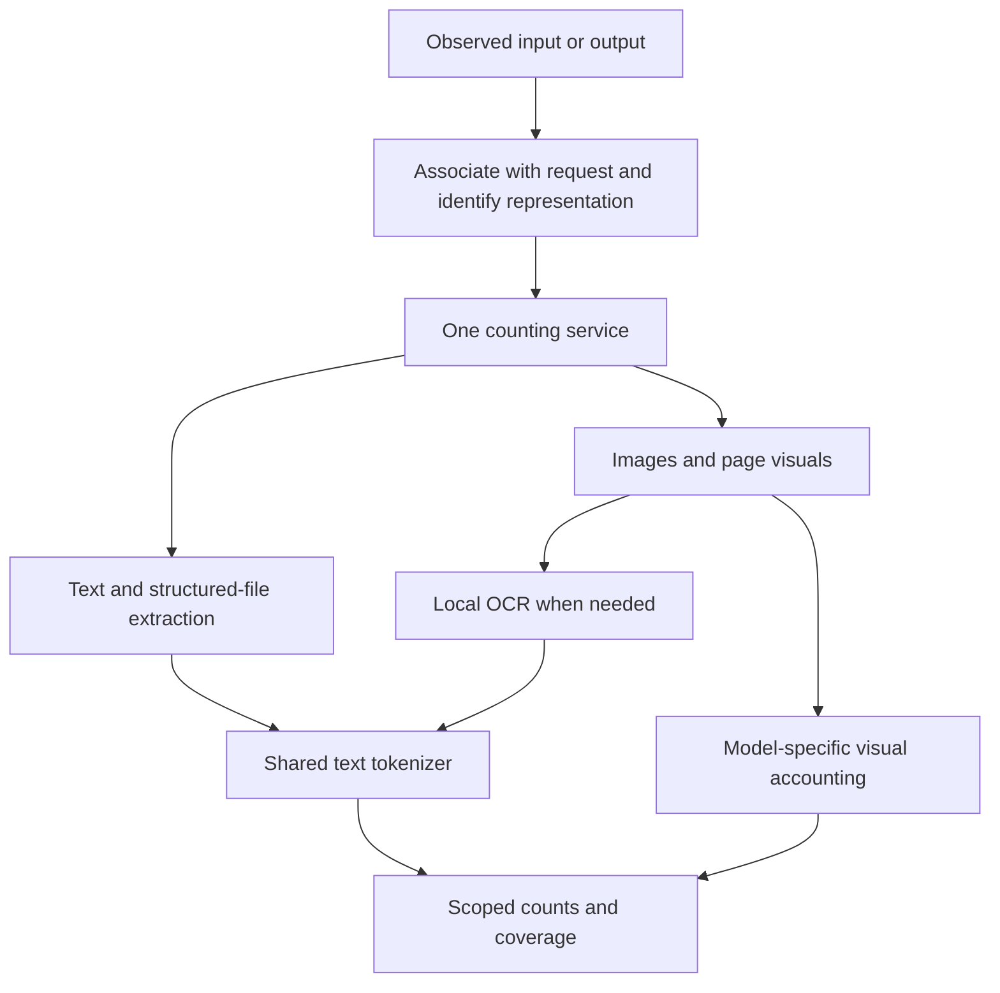

# Unified file and multimodal token counting

Research date: 16 September 2026. Recommendation only; no runtime, dependency, capture or accounting changes were made for this research.

## Decision

Keep one shared counting service and the existing browser-local text tokenizer. Improve the conversion and capture layers around it. Do not introduce a separate tokenizer for PDFs, another for spreadsheets and another for images.

For the current Chrome-first extension, the recommended stack is:

- Existing `gpt-tokenizer` for all extracted and captured text, with explicitly versioned encoding profiles.
- Existing PDF.js for text-native PDFs and, in a separate rendering path, page images needed for local OCR.
- Tesseract.js as the first browser-local OCR candidate to benchmark for scans and text in images.
- Structured Office extraction with explicit document order, spreadsheet cells and slide boundaries. Evaluate SheetJS CE against our current narrow XLSX parser for broader spreadsheet coverage.
- Model-specific image accounting inside the same counting service. OCR text counts and image-token estimates are different quantities.
- Capture generated artifact text and tool-call arguments before file serialization when those are exposed by an observed provider protocol.

If a separately installed local helper becomes acceptable, Docling is the strongest candidate in this review for a unified advanced document-conversion layer. It is a Python-based option, not a drop-in replacement inside our extension workers. This recommendation is based on documented capabilities and deployment fit, not a measured accuracy or performance ranking.

## What the app already does

The current architecture already has one shared text-counting implementation. `packages/file-text/src/index.ts` extracts text and calls `countText` from `@footprint/tokenizers/worker`; it does not use an independent file tokenizer. Live, historical and file workers share trusted counting-runtime metadata.

The packaged implementation is `gpt-tokenizer` 4.0.0. The default reference encoding is `o200k_base`, with `cl100k_base` also packaged. The code deliberately marks consumer-model mapping as unverified. Counting a string reproducibly under one encoding does not prove that Claude, Gemini or every ChatGPT model uses that encoding.

Current extraction coverage is:

| Format | Implemented extraction | Main gaps |
| --- | --- | --- |
| Plain text | Strict UTF-8 | Other encodings and additional structured formats |
| PDF | PDF.js text items in extraction order | Scans, OCR, visual content and reliable complex reading order |
| DOCX | Selected document/header/footer/footnote/endnote XML text | Full relationship/visibility semantics and layout |
| XLSX | Inline/shared strings and cached cell values | Formula/result distinctions, formatting, date rendering, drawings and sheet visibility |
| PPTX | Slide XML text ordered by part filename | Presentation relationship order, notes, drawings and layout |
| Images | No general file-image token counter | OCR and model-specific image accounting |

The existing file-count result has scope `extracted_file_text` and is non-additive to normal request-token and footprint totals. A parser successfully reading a file is also separate from proving that the file belongs to a particular provider request. Current generated-file contents are not automatically added to output tokens.

Relevant implementation: [file extraction](../../packages/file-text/README.md), [shared tokenizer](../../packages/tokenizers/README.md), [file dispatch to the shared counter](../../packages/file-text/src/index.ts), [packaged runtime](../../apps/extension/lib/counting-config.ts), and [Claude output extraction](../../packages/adapters/src/claude.ts).

## What provider documentation establishes

### There is no universal exact tokenizer for all modalities and providers

Anthropic's counting endpoint accepts structured messages, tools, images and PDFs and returns an input-token estimate for the selected model. Its documentation also distinguishes tokenizer generations. This is evidence against treating our OpenAI reference encoding as an exact Claude tokenizer. It does not mean that making an API count request reproduces a consumer website's hidden context or processing. [Claude token counting](https://platform.claude.com/docs/en/build-with-claude/token-counting).

Google provides input counting and response usage for multimodal requests. Its image, audio and video accounting is modality-specific. A text BPE encoder cannot replace those rules. [Gemini token counting](https://ai.google.dev/gemini-api/docs/tokens).

For a browser extension, the strongest evidence is a verified usage report exposed for the actual request. Provider count endpoints are useful for a known matching API payload, but they require transmitting the content and do not reveal an unrelated website request's hidden work. This research does not recommend adding external counting calls to the current local-only path.

### PDF text alone is not the entire model input

Claude's documented visual PDF path provides extracted page text alongside page images. OpenAI's documented vision-capable PDF path also includes both text and page images. The visual representation can therefore consume tokens even when all embedded text has been extracted successfully. These are API behaviors; equivalent consumer-site behavior still needs observation. [Claude PDF support](https://platform.claude.com/docs/en/build-with-claude/pdf-support), [OpenAI file inputs](https://developers.openai.com/api/docs/guides/file-inputs).

### Spreadsheet contents and provider input can differ substantially

OpenAI documents a spreadsheet augmentation flow that uses up to the first 1,000 rows per sheet with summary/header metadata rather than simply inserting the whole workbook. Tool-based spreadsheet analysis is another possible path. Counting every cell is a useful measure of workbook content, but cannot be assumed to equal the model input. [OpenAI file inputs](https://developers.openai.com/api/docs/guides/file-inputs).

### An image has visual tokens even when it contains no text

OpenAI documents model-dependent patch or tile accounting, resizing and detail settings. It separately distinguishes vision inputs from image-generation accounting. OCR can count words appearing in an image, but does not measure the visual model input. Image-input rules must not be reused as generated-image output rules. [OpenAI images and vision](https://developers.openai.com/api/docs/guides/images-vision).

## Candidate assessment

| Candidate | Role and documented strengths | Fit for this project |
| --- | --- | --- |
| PDF.js | Mozilla's browser-oriented PDF parsing/rendering platform | Keep. Improve extraction policy and add a separate bounded rendering path for OCR. |
| Tesseract.js | Browser/Node OCR using WebAssembly; does not directly accept PDF documents | First local OCR candidate. Render selected PDF pages with PDF.js before recognition. Benchmark on our documents before adoption. |
| SheetJS CE | Browser-capable spreadsheet import/export and broad spreadsheet-format support | Candidate to replace or expand the narrow XLSX parser. Preserve cell structure; do not assume formula calculation or provider-equivalent input. |
| Docling | Structured document representation; PDF layout, reading order, tables, OCR and Office/image support; local execution | Preferred candidate if a local helper is allowed. Larger deployment change than a browser dependency. |
| Microsoft MarkItDown | Python conversion of many document formats into Markdown | Good simpler conversion alternative. Markdown conversion is not token accounting. Its optional vision/OCR and cloud features must not be mistaken for automatically local processing. |
| Unstructured | Broad format-specific partitioning with structured elements | Useful in a backend ingestion system. Its Python/system-dependency footprint is less suitable for our browser-only default. |
| Scribe.js | Browser/Node PDF text extraction and OCR in one library | Worth a PDF/OCR comparison. Its repository declares AGPL-3.0; evaluate distribution implications separately before adoption. It is not a universal Office/media tokenizer. |

Primary project sources: [PDF.js](https://github.com/mozilla/pdf.js), [Tesseract.js](https://github.com/naptha/tesseract.js), [SheetJS](https://docs.sheetjs.com/docs/), [Docling](https://github.com/docling-project/docling), [MarkItDown](https://github.com/microsoft/markitdown), [Unstructured](https://github.com/Unstructured-IO/unstructured), [Scribe.js](https://github.com/scribeocr/scribe.js).

The current [gpt-tokenizer project](https://github.com/niieani/gpt-tokenizer) supports JavaScript environments and multiple OpenAI BPE encodings. Changing it alone would not recover missing OCR, table structure, tool arguments or visual-token accounting. This review does not independently validate the project's performance claims or every model mapping it advertises.

## Recommended common pipeline

The shared service should accept request association, direction, provider/model, representation kind and accessible bytes or observed content. It should return numerical counts with the extraction/tokenizer/image profile and whether the count is observed, modeled, content-only or unavailable. These are internal accounting distinctions, not a requirement to put technical labels throughout the normal interface.

Use format-specific readers underneath that service:

1. **Text, code, CSV and JSON:** preserve meaningful text and structure. Do not replace BPE with a characters-per-token shortcut when the encoder is available.
2. **Text-native PDFs:** extract text in a declared order, retaining page boundaries. For mixed/scanned PDFs, use OCR on regions/pages without adequate text. Avoid adding both an existing text layer and OCR of the same content.
3. **Spreadsheets:** retain workbook/sheet/row/cell structure, typed values and explicit formula/result policy. Serialize deterministically. Do not execute macros, calculate sheets or expand formulas simply to manufacture a token total.
4. **DOCX and PPTX:** follow document relationships and presentation order. Define whether headers, notes, hidden content and embedded images are included. A versioned extraction policy makes counts reproducible.
5. **Images:** use the selected provider/model's supported visual profile with dimensions and detail settings when known. OCR provides an optional text-content count, not a replacement for visual accounting. If the consumer model or preprocessing is unknown, a reference profile may be offered as an explicit estimate; it is not a verified provider count.
6. **Audio/video, if later required:** add modality adapters and accounting profiles. Transcript tokens measure transcript text, not automatically the audio/video model input.

Do not convert every format to PDF first. That can lose spreadsheet semantics and change the visual input representation. Do not tokenize ZIP contents, compressed bytes, base64 strings or XML package metadata as though they were the model's document input.

## Input and output need different attribution rules

The same extraction and text-tokenization service can count the content of both uploaded and generated files. Their relationship to model work differs.

For inputs, prefer the actual observed representation supplied to the model. A complete uploaded workbook may be retrieved selectively or processed by a tool. A whole-file content count should therefore remain distinguishable from request input tokens.

For outputs, prefer verified usage metadata or captured generated text/tool arguments/artifact source. A short generated script can create a spreadsheet with a million rows. Counting every cell of that spreadsheet does not mean the language model generated that many tokens. The same problem occurs with repeated PDF templates, charts, embedded pictures and copied source material.

Consequently, the service should distinguish:

- **Model-work tokens:** supported evidence of model input/output, including observed tool-call arguments where properly captured and scoped.
- **File-content reference tokens:** the tokenized content of an input/output file under our declared extraction and reference encoding.
- **Visual/media counts:** applicable provider/model estimates or observed usage, with separate modality and direction.

Only add components when their representations, scopes and overlap are known. A response plus an identical downloadable document must not automatically count the same content twice. Repeated download events are not repeated generation. Conversely, a file genuinely reused in a later model request can contribute again to that later request if processing evidence supports it.

The present EcoLogits text estimator consumes an output-token workload. Do not silently feed extracted spreadsheet-cell totals, OCR counts or input-image token estimates into that output-token field. Wider file coverage needs an explicit footprint mapping for the newly observed workload. File extraction does not on its own measure code execution or document-rendering energy.

## Adoption order and evidence still needed

1. Keep the shared tokenizer and current local worker boundary. Define a common extracted-document representation with text, table cells, image assets, source locations and inclusion rules.
2. Benchmark current extraction against the proposed alternatives on representative synthetic/public files. Cover multi-column PDFs, scans, mixed text/image pages, multilingual text, spreadsheets with formulas/dates/merged cells, DOCX revisions and reordered PPTX slides.
3. First expand local OCR and spreadsheet/Office fidelity where the benchmark demonstrates a useful gain. Measure cold/warm latency, peak memory, cancellation and impact on the host page in Chrome, Edge and Firefox.
4. Add observed generated-artifact/tool-argument capture and request association. Test upload reuse, revisions, streaming replacements, retries, regenerated files and repeated downloads without double-counting.
5. Add versioned visual-input profiles where actual model/preprocessing evidence supports them. Keep generated-image accounting separate.
6. Introduce Docling as an optional local helper only if browser-only extraction cannot meet the demonstrated requirements. Preserve the same counting-service interface and reference-count semantics.

Success means every encountered file has a truthful coverage outcome, not that every possible file is forced into a number. Unsupported, encrypted, inaccessible and over-limit files must remain explicit. A failed parser must not become a zero-token result.

No alternative parser was installed, benchmarked or connected to user files for this report. Official documentation and the current repository establish architectural fit and the accounting limitations; they do not establish a universal extraction-accuracy winner.
